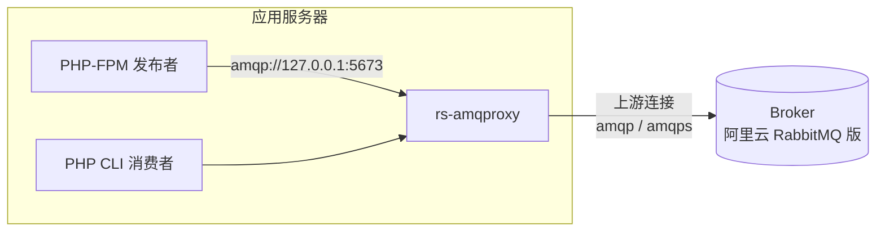
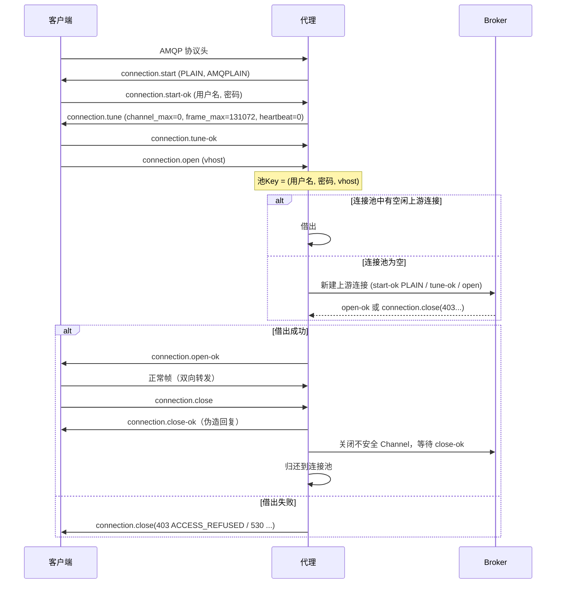
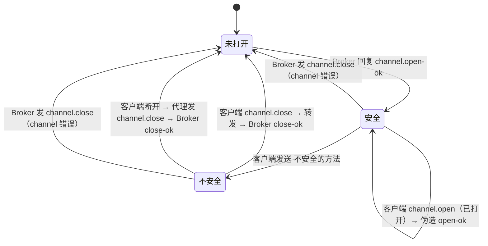

# rs-amqproxy 设计说明

本文说明 rs-amqproxy 第一版的整体设计。术语以 [GLOSSARY.md](../GLOSSARY.md) 为准，关键决策见 [docs/adr/](./adr/)。

## 1. 目标与验收

| 项目 | 内容 |
|---|---|
| 目标 | 用 Rust 复刻 cloudamqp/amqproxy **v0.4.4** 的全部能力，可以直接替换原版二进制 |
| 问题 | 原版长期运行后内存持续增长，而且新版本无法在 CentOS 7.4 上编译 |
| 客户端 | PHP 7.3（FPM 短连接发布 + 常驻 CLI 消费者），php-amqplib 3.1.0，heartbeat=0，keepalive=false |
| Broker | 阿里云 RabbitMQ 版（AMQP 0-9-1） |
| 部署 | 每台应用服务器部署一个代理，监听本机地址 |
| 验收 | 24 小时压测：预热后 RSS 增长 < 5%；所有客户端断开且超过空闲超时后，内存回到基线 |

## 2. 整体结构



一个客户端连接在任一时刻只绑定一个上游连接（[ADR-0001](./adr/0001-copy-v0-4-4-one-to-one-model.md)）：

```
客户端A ──► 上游连接1 ─┐
客户端B ──► 上游连接2 ─┼─► Broker
         连接池: {池Key → [空闲上游连接...]}
```

## 3. 命令行接口（与 v0.4.4 兼容）

```
amqproxy [options] [amqp upstream url]
```

| 参数 | 环境变量 | 默认值 | 说明 |
|---|---|---|---|
| `-l, --listen=ADDRESS` | `LISTEN_ADDRESS` | `localhost` | 监听地址 |
| `-p, --port=PORT` | `LISTEN_PORT` | `5673` | 监听端口 |
| `-d, --debug` | — | 关闭 | DEBUG 日志 |
| `-t, --idle-connection-timeout=SECONDS` | — | `5` | **新增**。空闲超时 |
| `-h, --help` | — | — | 显示帮助 |
| `-v, --version` | — | — | 显示版本 |
| 位置参数 | `AMQP_URL` | 必填 | 只使用 scheme、host、port。`amqp` 默认端口 5672，`amqps` 默认端口 5671 |

- 优先级：命令行 > 环境变量 > 默认值。
- URL 中的用户名、密码和 vhost 会被忽略，由客户端提供。
- 其他 scheme，或缺少 host 时，打印错误并退出（非 0）。

## 4. 连接生命周期



**先借出上游连接，成功后才回复 `open-ok`**（[ADR-0002](./adr/0002-intentional-deviations-from-v0-4-4.md) 第 6 项）。

### 4.1 上游连接握手

- `connection.start-ok`：机制固定为 PLAIN，`client_properties` 中 product=`AMQProxy`。
- `connection.tune-ok`：`channel_max` = Broker 的值；`frame_max` = `min(Broker 的值, 131072)`；`heartbeat` 见第 7 节。
- 如果 Broker 回复 `connection.close`（例如 403），这个错误会转给客户端。

### 4.2 归还与丢弃

| 情况 | 结果 |
|---|---|
| 客户端正常关闭，所有不安全 Channel 都在超时前收到 `close-ok` | 归还 |
| 客户端异常断开（EOF/错误），不在消息内容传输中 | 关闭不安全 Channel 后归还 |
| 客户端在消息内容（header/body 帧）传输中断开 | **丢弃**（关闭上游连接） |
| 等待 `channel.close-ok` 超时 | 丢弃 |
| 上游连接已断开、读写出错或心跳超时 | 丢弃，并向客户端发 `connection.close(320, "UPSTREAM_ERROR")` |

## 5. Channel 复用规则

代理为每个上游连接记录两个集合：**已打开的 channel** 和 **不安全 Channel**。



| 客户端发出的方法 | 是否安全 |
|---|---|
| `basic.publish`（60/40）、`basic.qos`（60/10） | 安全 |
| `basic.get`（60/70）且 `no_ack=true` | 安全 |
| `basic.get` 且 `no_ack=false` | 不安全 |
| 其他所有 `basic.*`（consume、ack、nack、reject、recover、cancel…） | 不安全 |
| `confirm.select`（85/10） | 不安全 |
| `tx.select`（90/10） | 不安全（[ADR-0002](./adr/0002-intentional-deviations-from-v0-4-4.md) 第 1 项） |
| `exchange.*`、`queue.*` 等 | 安全（与 v0.4.4 相同） |

### 5.1 上游连接在连接池中时收到的帧

| 帧 | 处理 |
|---|---|
| 心跳 | 正常处理 |
| `channel.close` | 回复 `close-ok`，从"已打开"集合中删除 |
| `connection.close` | 回复 `close-ok`，丢弃这个上游连接 |
| 其他帧 | 记录 WARN 日志，丢弃这个上游连接（状态已不可信） |

## 6. 帧处理

自己实现最小的编解码器（[ADR-0003](./adr/0003-minimal-frame-codec.md)）：

```
+------+---------+---------+-------------+-----+
| type | channel | size    | payload     | 0xCE|
| 1B   | 2B      | 4B      | size 字节    | 1B  |
+------+---------+---------+-------------+-----+
```

- 只解码方法帧的 class id 和 method id，以及少数字段：握手字段、`basic.get.no_ack`、`connection.close` / `channel.close` 的字段。
- 其他帧用 `bytes::Bytes` 原样转发。
- 帧大小超过 frame_max，或结尾不是 `0xCE` 时：关闭客户端连接（`501 FRAME_ERROR`），并打印清楚的日志。
- 客户端认证：支持 PLAIN 和 AMQPLAIN（php-amqplib 默认使用 AMQPLAIN）。

## 7. 心跳与存活检测

[ADR-0005](./adr/0005-proxy-owns-upstream-heartbeat.md)：

| 方向 | 做法 |
|---|---|
| 客户端 ↔ 代理 | Tune 时给 heartbeat=0。收到客户端心跳就回送。**不会**因为客户端空闲而断开它 |
| 代理 ↔ Broker | 使用 Broker 建议的值；如果为 0，就用 60 秒。代理主动发送心跳，超过 2 个周期没有收到任何数据，就判定上游连接已死 |
| TCP | 两侧 socket 都开启 keepalive（idle 60s、interval 10s、count 3）和 TCP_NODELAY |

## 8. 内存保证

| 措施 | 目的 |
|---|---|
| frame_max 上限 131072 | 每个帧的缓冲区大小有上限 |
| 每个方向使用有界缓冲区，读取受写入速度限制（背压） | 慢客户端不会让内存无限增长 |
| 断开时关闭两侧 socket，释放所有任务 | 不留下孤立任务 |
| 池 Key 下没有连接时，删除这个 Key | 连接池中的 Map 不会无限增长 |
| 空闲超时回收 | 连接池中的连接数量会回到 0 |
| jemalloc + 后台归还内存（[ADR-0004](./adr/0004-musl-static-binary-with-jemalloc.md)） | 防止碎片让 RSS 持续增长 |

## 9. 日志与统计

- 输出到 stdout，带时间戳。默认 INFO，`-d` 开启 DEBUG。
- 每 5 秒输出一行：`clients=N upstreams=M rss=XXMB`。

## 10. 关闭（SIGINT / SIGTERM）

1. 停止接受新连接。
2. 向所有客户端发送 `connection.close(320, "AMQProxy shutdown")`。
3. 关闭连接池中的所有上游连接。
4. 退出（代码 0）。

## 11. 建议的模块划分

| 模块 | 职责 |
|---|---|
| `cli` | 解析命令行参数和环境变量 |
| `frame` | 帧编解码，以及少数方法字段的解析和生成 |
| `client_handshake` | 与客户端握手（start / tune / open），解析 PLAIN/AMQPLAIN |
| `upstream` | 上游连接：握手、TLS、心跳、channel 状态 |
| `pool` | 按池 Key 借出、归还、空闲回收 |
| `session` | 一个客户端连接和它绑定的上游连接之间的双向转发 |
| `server` | 监听、接受连接、关闭流程、统计日志 |

## 12. 测试

| 层 | 内容 | 运行方式 |
|---|---|---|
| 单元测试 | 帧编解码、channel 状态机、连接池 | `cargo test`，没有外部依赖 |
| 集成测试 | Docker 中的 RabbitMQ：发布、basic_get、consume、channel 复用、客户端异常断开、Broker 重启、认证失败、TLS | `cargo test --features integration` |
| 内存验收 | Docker 中的 PHP 7.3 + php-amqplib 3.1.0：短连接发布 + 常驻消费者 + 随机 kill + Broker 重启，持续 24 小时，记录 RSS 和 jemalloc 统计 | 本地脚本，输出 CSV 和结论 |

## 13. 构建与交付

- 目标：`x86_64-unknown-linux-musl` 静态二进制，文件名 `amqproxy`，安装路径 `/usr/bin/amqproxy`。
- systemd 文件只使用 systemd 219（CentOS 7）也支持的配置项，可以同时用于 Debian 12。
- 交付 tar.gz：二进制 + `amqproxy.service` + 中文 README。
- CI（GitHub Actions）：fmt、clippy、单元测试、musl 编译；打 tag 时发布 Release。
- 许可证：MIT。
